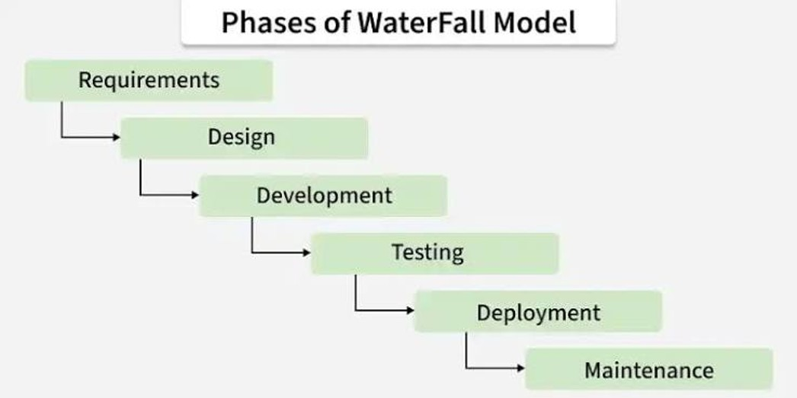

# Software_Engineering_Analysis

# Comparative Software Engineering Process Analysis: Modern E-Commerce Platforms vs. Safety-Critical Healthcare Systems

**Author:** Yino Alva[cite: 1]  
**Institution:** Concordia University Chicago[cite: 1]  
**Course:** BLA 02 - Software Engineering / Software Process[cite: 1]  
**Faculty Sponsor:** Dr. Visvasuresh (Victor) Govindaswamy[cite: 1]  

---

## 📌 Project Overview & Poster
This repository contains the software engineering research poster and supporting materials comparing software development process models in commercial high-volume e-commerce platforms (Shopify) and safety-critical health IT systems (Epic Systems)[cite: 1].

> 📄 **View Poster:** [Download Poster PowerPoint (PPTX)](Comparative%20Software%20Engineering%20Process%20Analysis%20Modern%20E-Commerce%20Platforms%20vs.%20Safety-Critical%20Healthcare%20Systems.pptx)
---

## 📝 Abstract

**Field:** This study presents a comparative software engineering evaluation examining how process models apply to two distinct domain case studies: Shopify (a high-volume commercial e-commerce platform) and Epic Systems (a safety-critical healthcare Electronic Health Record system)[cite: 1, 4]. The analysis evaluates how software specification, design/implementation, validation, and evolution function across fast-paced commercial and heavily regulated healthcare environments[cite: 1, 4]. While Shopify’s documented practices leverage microservices, automated continuous integration/continuous deployment (CI/CD) pipelines, and real-time cloud releases for continuous feature delivery, healthcare platforms like Epic Systems combine iterative internal development with structured plan-driven phase gates, Change Control Board (CCB) oversight, and multi-tier clinical simulation[cite: 1, 4]. This comparative study highlights how team workflows adapt to system reliability, security, and regulatory constraints[cite: 1, 4].

---

## ❓ Problem & Motivation
* **Why Software Process Matters:** Software engineering differs fundamentally from simple programming[cite: 1, 4]. Large-scale software involves millions of lines of code, multi-disciplinary team coordination, cost management, and evolution over many years[cite: 1, 4]. Without structured process models, software projects suffer from severe time overruns, uncoordinated architectural decisions, high maintenance costs, and critical reliability failures[cite: 1, 4].
* **Representative Domain Case Studies:** 
  * **Shopify Inc.:** Represents modern, market-driven web/cloud applications where competitive release velocity, system scalability, and continuous merchant feedback drive success[cite: 1, 4].
  * **Epic Systems Corporation:** Represents safety-critical, heavily regulated health IT where system failures directly impact patient safety and legal compliance, demanding rigorous oversight and formal verification[cite: 1, 4].

---

## ⚙️ Software Process Concepts
* **Four Core Process Activities:**
  1. *Specification (Requirements Engineering):* Establishing system capabilities, boundary conditions, and operational constraints[cite: 1, 4].
  2. *Design & Implementation:* Structuring system architecture, database models, REST APIs, and writing executable code[cite: 1, 4].
  3. *Validation:* Verifying and testing code via unit, integration, system, and user-acceptance testing (UAT)[cite: 1, 4].
  4. *Evolution:* Modifying and extending software over time to adapt to new market demands, regulatory updates, and security threats[cite: 1, 4].
* **Process Models Analyzed:**
  * **Waterfall:** A plan-driven, sequential workflow (Requirements → Design → Implementation → Testing → Deployment → Maintenance) ideal for stable requirements and safety-critical domains[cite: 1, 4].
  * **Incremental / Agile Development:** Interleaves specification, coding, and testing into small releases, lowering rework costs and incorporating continuous customer feedback[cite: 1, 4].
  * **Integration & Configuration:** Reuses pre-built components, commercial frameworks, and third-party APIs to speed up delivery[cite: 1, 4].

---

## 🏬 Case Study 1: E-Commerce Platform (Shopify)
* **Company & System:** Shopify Inc. — Global E-Commerce Merchant Platform[cite: 1, 4].
* **Users & Purpose:** Powers 2M+ online merchants and global shoppers; manages storefront rendering, product catalog navigation, checkout processing, and payment gateways[cite: 1, 4].
* **Development Approach:** Agile / DevOps / API-First Microservices Architecture / Component Reuse[cite: 1, 4].
* **Testing & Validation:** Automated CI/CD pipelines, automated unit/integration test suites, canary releases, and real-time cloud telemetry[cite: 1, 4].
* **Deployment & Maintenance:** Continuous delivery executing multiple production updates daily without merchant storefront downtime[cite: 1, 4].

---

## 🏥 Case Study 2: Healthcare Software (Epic Systems)
* **Company & System:** Epic Systems Corporation — EpicCare Electronic Health Record (EHR) System[cite: 1, 4].
* **Users & Purpose:** Doctors, nurses, pharmacists, and health administration staff; manages clinical workflows, patient records, and prescription orders[cite: 1, 4].
* **Development Approach:** Plan-Driven / Safety-Critical Waterfall Hybrid[cite: 1, 4].
* **Testing & Validation:** Multi-tier clinical simulation testing, strict role-based access verification, data integrity audits, and formal HIPAA/FDA compliance checks[cite: 1, 4].
* **Deployment & Maintenance:** Scheduled institutional release cycles (quarterly or annual updates) governed by formal Change Control Boards (CCB)[cite: 1, 4].

---

## 📊 Process Comparison Matrix

| Requirement Area | E-Commerce Domain (Shopify Case Study) | Healthcare Domain (Epic Systems Case Study) |
| :--- | :--- | :--- |
| **1. Requirements Specification** | Dynamic, feature-driven backlog prioritized via real-time merchant feedback, user telemetry, and A/B testing[cite: 1, 4]. | Formal upfront specification driven by clinical workflows, safety constraints, and regulatory rules (HIPAA / FDA)[cite: 1, 4]. |
| **2. System Design & Implementation** | API-first microservices architecture; high reliance on third-party integration and component reuse[cite: 1, 4]. | Modular clinical data engines with strict role-based access control (RBAC), data isolation, and auditable transactions[cite: 1, 4]. |
| **3. Software Verification & Validation** | Automated CI/CD build suites, automated unit/integration testing, feature flags, and canary deployments[cite: 1, 4]. | Multi-tier clinical simulation testing, automated HIPAA compliance audits, data integrity checks, and user acceptance testing (UAT)[cite: 1, 4]. |
| **4. Software Evolution & Maintenance** | Continuous deployment featuring multiple background production updates daily with minimal to zero merchant downtime[cite: 1, 4]. | Scheduled institutional release cycles (quarterly or annual updates) governed by formal Change Control Boards (CCBs)[cite: 1, 4]. |
| **5. Security & Regulatory Considerations** | PCI-DSS financial security compliance, data privacy standards, and automated vulnerability scanning in build pipelines[cite: 1, 4]. | Strict HIPAA Privacy & Security Rules, administrative oversight, immutable audit logging, and clinical safety compliance[cite: 1, 4]. |
| **6. Process Model Advantages & Limitations** | **Adv:** Rapid time-to-market and high adaptation to market changes[cite: 1, 4]. **Lim:** Complex microservice interaction testing & dependency risks[cite: 1, 4]. | **Adv:** High reliability, structured risk management, and regulatory compliance[cite: 1, 4]. **Lim:** Longer release cycles and higher cost of accommodating scope changes[cite: 1, 4]. |

---

## 🖼️ Original Software Engineering Visuals

### Visual Artifact 1: Plan-Driven Waterfall Lifecycle Model

### Visual Artifact 2: Agile / Incremental Delivery Loop Model

---

## 📈 Key Findings & Lessons Learned
* **Distinguishing Analysis vs. Internal Practices:** Documented engineering practices demonstrate that Shopify relies heavily on CI/CD microservices[cite: 1, 4], whereas healthcare systems like Epic Systems combine internal iterative sprints with rigid plan-driven release gates to meet safety standards[cite: 1, 4].
* **Managing Risk vs. Eradicating Defects:** No software process guarantees zero defects[cite: 1, 4]. Safety-critical software relies on systematic verification, documentation, and traceability matrices to mitigate clinical risk[cite: 1, 4], whereas commercial web applications manage risk via automated CI/CD checks, live site telemetry, and rapid rollbacks[cite: 1, 4].
* **Process Alignment:** Software processes must match domain risk profiles[cite: 1, 4]. E-commerce prioritizes release velocity and rapid customer feedback[cite: 1, 4], while healthcare prioritizes patient safety, security compliance, and strict operational auditability[cite: 1, 4].

---

## 🚀 Future & Emerging Considerations
* **Artificial Intelligence (AI):** AI-assisted code generation (GitHub Copilot), automated test case synthesis, predictive defect analysis, and AI-driven personalized budgeting/analytics[cite: 1, 2, 4].
* **DevOps & Infrastructure Automation:** Infrastructure-as-code and cloud microservices enabling zero-downtime updates[cite: 1, 4].
* **DevSecOps & Compliance Automation:** Automated static/dynamic vulnerability testing and automated HIPAA compliance validation directly integrated into build pipelines[cite: 1, 4].

---

## 📚 References
1. Govindaswamy, V. *Software Engineering Lecture 1 & 2: Basics of Software Engineering & Software Processes*. Course Presentation Slides, Concordia University Chicago[cite: 1, 4].
2. Shopify Engineering. *How Shopify Delivers Software at Scale: Continuous Delivery & Microservices*. Shopify Tech Blog[cite: 1, 4].
3. Epic Systems Corporation. *EpicCare Security Features & Healthcare Regulatory Compliance Standards*. Digital Health Engineering Guide[cite: 1, 4].
4. Accountable HQ. *Epic HIPAA Compliance: Administrative, Technical Controls, and Change Oversight*. Security & Compliance Guide[cite: 1, 4].
