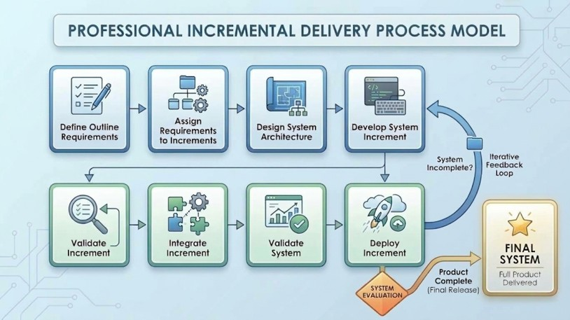

# From Release Velocity to Patient Safety: A Comparative Analysis of Software Engineering Processes in E-Commerce and Healthcare IT

**Author:** Yino Alva  
**Institution:** Concordia University Chicago  
**Course:** Software Engineering  
**Faculty Sponsor:** Dr. Visvasuresh (Victor) Govindaswamy  

---
## 🔗 Professional Portfolio & Links

- 💼 **LinkedIn Profile:** [Yino Alva on LinkedIn](www.linkedin.com/in/yino-alva-71a8403b0)
- 🎥 **YouTube Presentation:** [Watch Poster & Project Overview on YouTube](https://youtu.be/zG_2VjeATvY?si=o_Vs9oikju10-G0Z)

---

## 📌 Project Overview & Poster
This repository contains the software engineering research poster and supporting materials comparing software development process models in commercial high-volume e-commerce platforms (Shopify) and safety-critical health IT systems (Epic Systems).

> 📄 **View Poster:** [Download Poster PowerPoint (PPTX)](Comparative%20Software%20Engineering%20Process%20Analysis%20Modern%20E-Commerce%20Platforms%20vs.%20Safety-Critical%20Healthcare%20Systems.pptx)

---

## 📝 Abstract

**Field:** This study presents a comparative software engineering evaluation examining how process models apply to two distinct domain case studies: Shopify (a high-volume commercial e-commerce platform) and Epic Systems (a safety-critical healthcare Electronic Health Record system). The analysis evaluates how software specification, design/implementation, validation, and evolution function across fast-paced commercial and heavily regulated healthcare environments. While Shopify’s documented practices leverage microservices, automated continuous integration/continuous deployment (CI/CD) pipelines, and real-time cloud releases for continuous feature delivery, healthcare platforms like Epic Systems combine iterative internal development with structured plan-driven phase gates, Change Control Board (CCB) oversight, and multi-tier clinical simulation. This comparative study highlights how team workflows adapt to system reliability, security, and regulatory constraints.

---

## ❓ Problem & Motivation
- **Why Software Process Matters:** Software engineering differs fundamentally from simple programming. Large-scale software involves millions of lines of code, multi-disciplinary team coordination, cost management, and evolution over many years. Without structured process models, software projects suffer from severe time overruns, uncoordinated architectural decisions, high maintenance costs, and critical reliability failures.
- **Representative Domain Case Studies:** 
  * **Shopify Inc.:** Represents modern, market-driven web/cloud applications where competitive release velocity, system scalability, and continuous merchant feedback drive success.
  * **Epic Systems Corporation:** Represents safety-critical, heavily regulated health IT where system failures directly impact patient safety and legal compliance, demanding rigorous oversight and formal verification.

---

## ⚙️ Software Process Concepts
- **Four Core Process Activities:**
  1. *Specification (Requirements Engineering):* Establishing system capabilities, boundary conditions, and operational constraints.
  2. *Design & Implementation:* Structuring system architecture, database models, REST APIs, and writing executable code.
  3. *Validation:* Verifying and testing code via unit, integration, system, and user-acceptance testing (UAT).
  4. *Evolution:* Modifying and extending software over time to adapt to new market demands, regulatory updates, and security threats.
- **Process Models Analyzed:**
  * **Waterfall:** A plan-driven, sequential workflow (Requirements → Design → Implementation → Testing → Deployment → Maintenance) ideal for stable requirements and safety-critical domains.
  * **Incremental / Agile Development:** Interleaves specification, coding, and testing into small releases, lowering rework costs and incorporating continuous customer feedback.
  * **Integration & Configuration:** Reuses pre-built components, commercial frameworks, and third-party APIs to speed up delivery.

---

## 🏬 Case Study 1: E-Commerce Platform (Shopify)
- **Company & System:** Shopify Inc. — Global E-Commerce Merchant Platform.
- **Users & Purpose:** Powers 2M+ online merchants and global shoppers; manages storefront rendering, product catalog navigation, checkout processing, and payment gateways.
- **Development Approach:** Agile / DevOps / API-First Microservices Architecture / Component Reuse.
- **Testing & Validation:** Automated CI/CD pipelines, automated unit/integration test suites, canary releases, and real-time cloud telemetry.
- **Deployment & Maintenance:** Continuous delivery executing multiple production updates daily without merchant storefront downtime.

---

## 🏥 Case Study 2: Healthcare Software (Epic Systems)
- **Company & System:** Epic Systems Corporation — EpicCare Electronic Health Record (EHR) System.
- **Users & Purpose:** Doctors, nurses, pharmacists, and health administration staff; manages clinical workflows, patient records, and prescription orders.
- **Development Approach:** Plan-Driven / Safety-Critical Waterfall Hybrid.
- **Testing & Validation:** Multi-tier clinical simulation testing, strict role-based access verification, data integrity audits, and formal HIPAA/FDA compliance checks.
- **Deployment & Maintenance:** Scheduled institutional release cycles (quarterly or annual updates) governed by formal Change Control Boards (CCB).

---

## 📊 Process Comparison Matrix

| Requirement Area | E-Commerce Domain (Shopify Case Study) | Healthcare Domain (Epic Systems Case Study) |
| :--- | :--- | :--- |
| **1. Requirements Specification** | Dynamic, feature-driven backlog prioritized via real-time merchant feedback, user telemetry, and A/B testing. | Formal upfront specification driven by clinical workflows, safety constraints, and regulatory rules (HIPAA / FDA). |
| **2. System Design & Implementation** | API-first microservices architecture; high reliance on third-party integration and component reuse. | Modular clinical data engines with strict role-based access control (RBAC), data isolation, and auditable transactions. |
| **3. Software Verification & Validation** | Automated CI/CD build suites, automated unit/integration testing, feature flags, and canary deployments. | Multi-tier clinical simulation testing, automated HIPAA compliance audits, data integrity checks, and user acceptance testing (UAT). |
| **4. Software Evolution & Maintenance** | Continuous deployment featuring multiple background production updates daily with minimal to zero merchant downtime. | Scheduled institutional release cycles (quarterly or annual updates) governed by formal Change Control Boards (CCBs). |
| **5. Security & Regulatory Considerations** | PCI-DSS financial security compliance, data privacy standards, and automated vulnerability scanning in build pipelines. | Strict HIPAA Privacy & Security Rules, administrative oversight, immutable audit logging, and clinical safety compliance. |
| **6. Process Model Advantages & Limitations** | **Adv:** Rapid time-to-market and high adaptation to market changes. **Lim:** Complex microservice interaction testing & dependency risks. | **Adv:** High reliability, structured risk management, and regulatory compliance. **Lim:** Longer release cycles and higher cost of accommodating scope changes. |

---

## 🖼️ Original Software Engineering Visuals

### Visual Artifact 1: Plan-Driven Waterfall Lifecycle Model

### Visual Artifact 2: Agile / Incremental Delivery Loop Model

---

## 📈 Key Findings & Lessons Learned
- **Distinguishing Analysis vs. Internal Practices:** Documented engineering practices demonstrate that Shopify relies heavily on CI/CD microservices, whereas healthcare systems like Epic Systems combine internal iterative sprints with rigid plan-driven release gates to meet safety standards.
- **Managing Risk vs. Eradicating Defects:** No software process guarantees zero defects. Safety-critical software relies on systematic verification, documentation, and traceability matrices to mitigate clinical risk, whereas commercial web applications manage risk via automated CI/CD checks, live site telemetry, and rapid rollbacks.
- **Process Alignment:** Software processes must match domain risk profiles. E-commerce prioritizes release velocity and rapid customer feedback, while healthcare prioritizes patient safety, security compliance, and strict operational auditability.

---

## 🚀 Future & Emerging Considerations
- **Artificial Intelligence (AI):** AI-assisted code generation (GitHub Copilot), automated test case synthesis, predictive defect analysis, and AI-driven personalized budgeting/analytics.
- **DevOps & Infrastructure Automation:** Infrastructure-as-code and cloud microservices enabling zero-downtime updates.
- **DevSecOps & Compliance Automation:** Automated static/dynamic vulnerability testing and automated HIPAA compliance validation directly integrated into build pipelines.

---

## 📚 References
1. Govindaswamy, V. *Software Engineering Lecture 1 & 2: Basics of Software Engineering & Software Processes*. Course Presentation Slides, Concordia University Chicago.
2. Shopify Engineering. *How Shopify Delivers Software at Scale: Continuous Delivery & Microservices*. Shopify Tech Blog.
3. Epic Systems Corporation. *EpicCare Security Features & Healthcare Regulatory Compliance Standards*. Digital Health Engineering Guide.
4. Accountable HQ. *Epic HIPAA Compliance: Administrative, Technical Controls, and Change Oversight*. Security & Compliance Guide.
